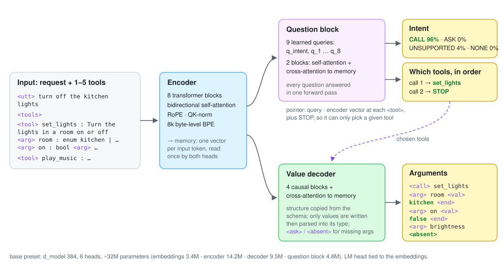

<h1 align="center">Eve</h1>

<p align="center">
  <b>A tiny function-calling model, built from scratch</b>
</p>

<p align="center">
  
  
  
  
  <a href="LICENSE"></a>
</p>

Eve reads a request and the schemas of 1–5 tools, then answers with whole tool calls: which tools, in what order, with which argument values, and how sure it is of each. It is a ~32M-parameter encoder-decoder written in plain PyTorch, with its own tokenizer, pretrained from random weights and fine-tuned on tool-calling data, and it is meant to run on a Raspberry Pi 5.

```console
$ uv run eve ask --tools set_lights,lock_door,play_music \
    "lock the front door and turn off the hallway lights" "turn on the lights"

lock the front door and turn off the hallway lights
  intent   call 99% · unsupported 1% · none 0% · ask 0%
  call 1   lock_door 100% · play_music 0% · STOP 0%
           door front 100% · locked true 100%
  call 2   set_lights 99% · lock_door 1% · STOP 0%
           room hallway 100% · on false 100% · brightness –

turn on the lights
  intent   ask 100% · unsupported 0% · call 0% · none 0%
  call 1   set_lights 100% · STOP 0% · play_music 0%
           room ? 100% · on true 100% · brightness –
```

The second request names no room, so Eve answers **ask** and marks `room` as the missing argument instead of guessing one.

> [!NOTE]
> Eve is under active development. Pretraining, fine-tuning, evaluation, calibration and the Python library work end to end; the PyPI release, published weights and the Raspberry Pi build are coming soon (see [Roadmap](#roadmap)).

## Overview

- **One pass for the decisions.** Eve doesn't generate its answer as text. A question block of learned queries reads the encoded request once and answers fixed questions: the intent (**call**, **ask**, **unsupported** or **none**) and "what is call #*i*?" for up to 8 calls.
- **Tools by pointer, not by name.** Each call slot scores the encoder's vector at every `<tool>` marker, plus a STOP key. Eve can only pick a tool it was given, so it can't invent a tool name, and the same head works for tools it never saw in training.
- **Values by a constrained decoder.** For each chosen tool, the call structure (`<call> set_lights <arg> room <val>`) is copied from the schema and the decoder writes only the values, which are then parsed into each argument's type. A required argument the user left out becomes `<ask>`, an optional one `<absent>`.
- **Calibrated probabilities.** Intent, tool and value probabilities are temperature-scaled, with separate temperatures for tools seen in training and new ones, since one temperature can't fit both.
- **Built from scratch.** Byte-level BPE tokenizer, attention, transformer blocks, T5-style span-corruption pretraining, training loop, checkpoints and evaluation are all in this repo; PyTorch is the only ML dependency.

<p align="center">
  
</p>

<p align="center"><sub><b>Figure 1.</b> Eve answers "turn off the kitchen lights" with two tools in its prompt.</sub></p>

## Results

`joint-base`: the ~32M `base` model pretrained on 850M tokens, then fine-tuned for 8,038 steps on intents, tools and argument values together.

| Eval set | What it measures | Exact ↑ | Macro recall ↑ | Values ↑ | Full call ↑ |
|---|---|---|---|---|---|
| `val` | tools seen in training | 83.3% | 72.8% | 90.4% | 63.0% |
| `massive-test` | [MASSIVE](https://github.com/alexa/massive) en-US test, converted to tool calls | 86.6% | 81.5% | 90.8% | 62.8% |
| `heldout-templates` | two domains (math, travel) never seen in training | 57.1% | 65.2% | 56.5% | 35.8% |

**Exact**: right intent and right tools in the right order. **Macro recall**: mean recall over the four intents. **Values**: argument values written correctly given the right tools. **Full call**: exact and every value right, i.e. the whole call.

<details>
<summary><b>Calibration</b></summary>

<br/>

Expected calibration error (15 bins) before → after temperature scaling. Familiar tools are fitted on `val`, new tools on a 200-example probe set.

| Eval set (familiar · new examples) | Intent | Tools | Values |
|---|---|---|---|
| `val` (2,213 · 258) | .060 → .037 | .025 → .020 | .017 → .015 |
| `probe` (40 · 160) | .398 → .167 | .162 → .058 | .224 → .145 |
| `heldout-templates` (201 · 1,799) | .345 → .198 | .160 → .033 | .282 → .165 |
| `massive-test` (2,960 · 0) | .022 → .042 | .010 → .022 | .015 → .015 |

A request counts as *familiar* when every tool's schema fingerprint is in the training data (4,854 schemas, stored in the checkpoint).

</details>

### Findings so far

- **New tools are the hard part.** On familiar tools the model is accurate and, after calibration, honest about it. On held-out tools it is confidently wrong: before calibration it was 99% sure of the intent and right 64% of the time.
- **It matches words, not meaning.** In 76% of training calls the request shares a content word with the tool's name. On new tools, Eve gets 71% of calls exact when they share a word and 30% when they don't. "20 plus 10" with an `add` tool is answered *unsupported*, and "make it warmer in here" doesn't find `set_thermostat`.
- **So the next fix is data, not size.** [TinyTools](data/tinytools/README.md) is a [TinyStories](https://arxiv.org/abs/2305.07759)-style pretraining corpus: short, simple documents about what people ask assistants for and what tools do, with random constraints per prompt to keep them varied. In a 2,000-document pilot, 98.6% passed the automatic checks first time; the next experiment pretrains with and without it on the same token budget and compares held-out accuracy.

## Roadmap

| Milestone | What | Status |
|---|---|---|
| M0 | Project setup, model presets | ✅ |
| M1 | Tokenizer, pretraining corpus, span corruption, task renderer | ✅ |
| M2 | Self, causal and cross attention | ✅ |
| M3 | Encoder, value decoder, question block | ✅ |
| M4 | Span-corruption pretraining | ✅ `small-250m`, `base-900m` |
| M5 | Checkpoints and loading pretrained weights | ✅ |
| M6 | Tool library and task data | ✅ |
| M7 | Classifier fine-tuning: the question heads | ✅ `questions-base` |
| M8 | Instruction fine-tuning: value decoder, joint run | ✅ `joint-base` |
| M9 | Metrics and calibration | ✅ |
| M10 | Python library (`Eve.load`, `eve.respond`) and inference on a Raspberry Pi 5 | 🚧 library done; PyPI release, weights and Pi coming soon |
| M11 | Retriever that picks the 1–5 tools to show the model | ✅ `retriever-base` |
| – | TinyTools pretraining corpus | 🚧 pilot done |

## Use it in Python

```bash
pip install eve-lm   # first release coming soon; until then:
pip install git+https://github.com/denskrlv/eve-lm.git
```

```python
from typing import Literal

from eve import Eve, tool

@tool
def set_lights(room: str, on: bool, brightness: int | None = None):
    """Turn the lights in a room on or off."""
    ...

@tool
def play_music(query: str, speaker: Literal["kitchen", "living room"] | None = None):
    """Play a song, artist or genre."""
    ...

eve = Eve.load("artifacts/runs/joint-base/model.pt")  # or a Hugging Face Hub repo id
eve.add_tools(set_lights, play_music)  # once; eve.tools.save("tools.json") keeps the schemas
response = eve.respond("turn off the kitchen lights")

response.intent        # "call", "ask", "unsupported" or "none"
response.confidence    # the intent's probability, calibrated
response.calls         # [Call(tool="set_lights", args={"room": "kitchen", "on": False}, ...)]
response.missing       # [("set_lights", "room")] when the intent is "ask"
response.run()         # calls set_lights(room="kitchen", on=False)
```

- **Tools** can be typed Python functions (`@tool`: the docstring is the description, `Literal` an
  enum, a default or `| None` makes an argument optional, `Annotated[int, Param(min=0, max=100)]`
  adds a range), OpenAI- or MCP-style JSON Schema dicts, or Eve's own schema dicts.
- **Registered tools:** `add_tools` registers tools for every request; `eve.tools` is the
  registry (`remove`, `save`, `ToolBox.load`). Eve reads at most 5 tools per request, so with
  more registered it first picks the 5 that best match the request. With a `retriever.pt` beside
  the model, a bi-encoder fine-tuned from Eve's encoder picks them by meaning; without one, word
  overlap (BM25). With 25 registered, every correct tool makes the 5 for 99.4% of val requests
  (BM25: 75.8%) and 95.8% on tools it never trained on (BM25: 77.1%). `respond(text, tools=[...])`
  uses exactly the tools given instead.
- **`Response`**: `intent` and `confidence`, all four `intents`, `calls` (each with `args`, its
  `confidence`, `arg_confidence`, `missing` and `invalid`), `considered` (the tools Eve read),
  `familiar_tools` (whether the model trained on every tool, which picks the calibration) and
  `to_dict()` for JSON.
- **`run()`** calls your functions only when everything is in place: the intent is `call`, every
  call has all its arguments, and optionally every probability is at least `min_confidence`.
  Otherwise it raises `EveError`, and nothing runs.
- **Limits:** Eve reads 1–5 tools per request; arguments are `str`, `int`, `float`, `bool` or an enum of
  strings. Accuracy is highest on tools like the ones Eve trained on (see [Results](#results)).
- `eve export MODEL --repo user/name` writes an fp16 `model.pt` (~63 MB) and a model card for a
  Hub repo, so `Eve.load("user/name")` can download it. `--retriever RETRIEVER` adds
  `retriever.pt` (~35 MB), which `Eve.load` picks up.

## Quick start

For training and development. Requires Python 3.12+ and [uv](https://docs.astral.sh/uv/). Training runs on CUDA, Apple Silicon (MPS) or CPU; outside this repo, training needs `pip install 'eve-lm[train]'`.

```bash
git clone https://github.com/denskrlv/eve-lm.git && cd eve-lm
uv sync
uv run pytest            # about 390 tests, 30 s on a laptop
uv run eve model         # parameters per part of each preset
```

Published weights are coming soon. Until then, `eve ask` and `Eve.load` need a model you trained: follow [Training](#training) below.

## Training

The whole pipeline, from raw text to a calibrated model. Each command writes where the next one reads.

| Step | Command |
|---|---|
| 1. Tokenizer: 8k byte-level BPE on web text, tool schemas and commands | `uv run eve tokenizer train` |
| 2. Pretraining corpus: FineWeb-Edu to token ids | `uv run eve corpus encode` |
| 3. Pretrain with span corruption | `uv run eve run configs/experiments/base-900m.toml` |
| 4. Task data: hand-written tools, templates, chat-written requests, xLAM, MASSIVE | `uv run eve data external && uv run eve data build` |
| 5. Fine-tune intents, tools and values together | `uv run eve run configs/experiments/joint-base.toml` |
| 6. Evaluate | `uv run eve evaluate artifacts/runs/joint-base` |
| 7. Fit and save the temperatures | `uv run eve calibrate artifacts/runs/joint-base --save` |
| 8. Try it | `uv run eve ask --tools set_lights,play_music "turn off the kitchen lights"` |

<details>
<summary><b>Downloading the data</b></summary>

<br/>

Pretraining uses one [FineWeb-Edu](https://huggingface.co/datasets/HuggingFaceFW/fineweb-edu) shard (about 700M tokens) for `small-250m`; `base-900m` needs two.

```bash
mkdir -p data/raw/fineweb-edu
curl -L -o data/raw/fineweb-edu/000_00000.parquet \
  https://huggingface.co/datasets/HuggingFaceFW/fineweb-edu/resolve/main/sample/10BT/000_00000.parquet
uv run eve tokenizer train                  # -> artifacts/tokenizer/eve-8k.json
uv run eve corpus encode                    # 250M train + 2M val tokens -> data/bin/
curl -L -o data/raw/fineweb-edu/001_00000.parquet \
  https://huggingface.co/datasets/HuggingFaceFW/fineweb-edu/resolve/main/sample/10BT/001_00000.parquet
uv run eve corpus encode --train-tokens 900M --out data/bin-900m   # for base-900m: both shards
```

Fine-tuning mixes in two external datasets, converted to Eve's format with the held-out domains removed: [xLAM function-calling 60k](https://huggingface.co/datasets/Salesforce/xlam-function-calling-60k) (gated: accept its terms on Hugging Face first) and [MASSIVE](https://github.com/alexa/massive) en-US (CC BY 4.0).

```bash
uvx --from huggingface_hub hf download Salesforce/xlam-function-calling-60k \
  --repo-type dataset --local-dir data/raw/xlam
mkdir -p data/raw/massive && curl -L https://amazon-massive-nlu-dataset.s3.amazonaws.com/amazon-massive-dataset-1.1.tar.gz \
  | tar -xz -C data/raw/massive --include '*/en-US.jsonl'
uv run eve data external                    # -> data/external/*.jsonl
uv run eve data build                       # -> data/task/*.jsonl
```

</details>

<details>
<summary><b>Pretraining</b></summary>

<br/>

T5-style span corruption: spans of the input are replaced with sentinels (`<x0>`, `<x1>`, …) and the decoder writes them back. It trains the encoder and the decoder, the parts fine-tuning starts from.

```bash
uv run eve run configs/experiments/small-250m.toml   # ~12M parameters, 250M tokens, 13,730 steps
uv run eve run configs/experiments/base-900m.toml    # ~32M parameters, 850M tokens, 46,682 steps
uv run eve run configs/experiments/base-900m.toml --set run.resume=true   # continue after an interruption
uv run eve pretrain --preset small --rope --qk-norm --lr 2e-3 --stop-after 2000 --out artifacts/runs/ab-lr2e-3
```

Both recipes came out of A/B runs at the small size: no dropout, rotary positions and QK-norm, and `torch.compile` (about 2× faster on MPS). An A/B arm uses the full run's schedule and stops early, so the winner continues with `--resume`. The number to watch is `val_content`, the loss on the words inside the holes only.

```bash
uv run eve fill "Paris is the capital of <x0>."   # prompt a pretrained model
uv run eve compare artifacts/runs/ab-*            # val metrics of several runs side by side
```

[`notebooks/kaggle-train.ipynb`](notebooks/kaggle-train.ipynb) runs the same pipeline on a free Kaggle T4. `base-900m` takes 10–11 hours, on a T4 or on an M3 Pro alike.

</details>

<details>
<summary><b>Task data</b></summary>

<br/>

- **Hand-written tools.** 46 tools in 12 everyday domains (home, media, calendar, car, math, …) in [`data/tools/`](data/tools), each with request templates. [`data/tools/heldout/`](data/tools/heldout) holds 4 more, travel, that the model never trains on. Until 2026-10-28 math was held out too (the models in [Results](#results) never saw it).
- **Generated tools.** 1,042 more tools are generated in code, so the model learns to read schemas rather than memorise names.
- **Chat-written requests.** Code picks the answer for each scenario (intent, calls, missing arguments) and an LLM writes only the request, following [`data/generation/README.md`](data/generation/README.md); `eve data check` rejects any request that doesn't lead to exactly those calls.
- **External data.** xLAM and MASSIVE, converted.
- **Splits.** `val`, `heldout-templates` (only held-out tools), `massive-test` and `probe-candidates` (a small mixed set for calibrating new tools).

```bash
uv run eve data batch --split val --ask 0.4   # scenarios for a chat to write requests for
uv run eve data check batch-0001              # validate what it wrote
```

</details>

<details>
<summary><b>Fine-tuning, evaluation and calibration</b></summary>

<br/>

```bash
uv run eve run configs/experiments/joint-base.toml   # intents, tools and values: the main recipe
uv run eve finetune --init artifacts/runs/base-900m/model.pt --freeze --out artifacts/runs/frozen   # question block only
uv run eve finetune --scratch small --out artifacts/runs/scratch   # no pretraining, for comparison
```

`eve evaluate` scores a model on whole task files: recall per intent and their mean, exact, value and full-call accuracy, and a confusion table of intents. `--by-tool` adds a row per tool, worst first.

```bash
uv run eve evaluate artifacts/runs/joint-base --sets heldout-templates --by-tool
uv run eve calibrate artifacts/runs/joint-base --save   # fits intent, tool and value temperatures
uv run eve ask --json --tools set_lights,play_music "dim the bedroom lights to 30"
uv run eve ask --schema my_tools.json                   # your own schemas; no request: type them one by one
```

</details>

<details>
<summary><b>Experiments and components</b></summary>

<br/>

Every part of a training run is a component registered under a kind and a name (`data`, `model`, `loss`, `metrics`, `report`, `optimizer`, `schedule`, `callback`, `trainer`). The trainer is handed built components and never imports a model, dataset or loss. An experiment file picks one per kind:

```toml
[components]
data = "task"
loss = "joint"          # swap a component: change its name
metrics = "joint"
report = "task_scores"

[model]
init = "artifacts/runs/base-900m/model.pt"

[train]
epochs = 2.0
lr = 3e-4

[run]
out = "artifacts/runs/joint-base"
```

```bash
uv run eve run configs/experiments/joint-base.toml
uv run eve run configs/experiments/joint-base.toml --set components.loss=question \
  --set components.metrics=question --set report.values=false --set train.lr=1e-3 \
  --set run.out=artifacts/runs/questions-only
```

Params are layered, later ones winning: the component's file in `configs/components/`, the experiment's table, then `--set section.key=value`. An unknown param stops the run instead of being ignored. Every run writes its resolved experiment to `<out>/config.toml`, so `eve run <out>/config.toml` repeats it; `last.pt` holds the weights, optimizer and RNG states, so `--set run.resume=true` continues exactly. The checkpoints' meta says whether the joint loss trained them (`joint`) and where they started (`init`), taken from the components, so a `--set` can't leave it stale.

**Adding a component.** Register it with `@register(kind, name)` in a new module, give it its kind's call signature from [`src/eve/components.py`](src/eve/components.py) with config params as keyword arguments, and add `configs/components/<kind>/<name>.toml` with its defaults. [`tests/test_components.py`](tests/test_components.py) checks the config and runs a smoke test on every registered component.

</details>

<details>
<summary><b>Model configuration</b></summary>

<br/>

Presets from [`src/eve/config.py`](src/eve/config.py):

| Preset | d_model | Heads | Encoder | Decoder | Question block | Parameters |
|---|---|---|---|---|---|---|
| `tiny` (tests) | 64 | 2 | 2 | 1 | 1 | 0.8M |
| `small` | 256 | 4 | 6 | 3 | 2 | 12.3M |
| `base` | 384 | 6 | 8 | 4 | 2 | 31.9M |
| `medium` | 512 | 8 | 8 | 4 | 2 | 55.1M |

| Component | Configuration |
|---|---|
| Tokenizer | byte-level BPE, 8,192 tokens, trained with tool schemas and commands weighted 50× |
| Input | up to 512 encoder tokens (request + 5 schemas), 256 decoder tokens, up to 8 calls |
| Body | pre-norm transformer blocks, rotary positions and QK-norm (`base-900m`), LM head tied to the embeddings |
| Question block | 1 + 8 learned queries, non-causal decoder blocks; linear intent head; pointer slot head (64-d) over `<tool>` vectors + STOP |
| Fine-tuning loss | intent and slot cross-entropy + decoder cross-entropy on value tokens |
| Optimisation | AdamW, linear warmup and cosine decay |

</details>

<details>
<summary><b>Repository layout</b></summary>

<br/>

```
eve-lm/
├── assets/                # Architecture figure
├── configs/
│   ├── components/        # Default params per component: <kind>/<name>.toml
│   └── experiments/       # Whole experiments for `eve run`: pretraining, joint, retriever
├── data/
│   ├── tools/             # Hand-written tool schemas; heldout/ is never trained on
│   ├── generation/        # Scenario batches and the chat-written requests
│   └── tinytools/         # TinyTools word lists, prompts and pilot documents
├── notebooks/             # Pretraining on Kaggle
├── src/eve/
│   ├── tokenizer/         # Byte-level BPE
│   ├── model/             # Attention, blocks, embeddings, the Eve model, checkpoints
│   ├── data/              # Corpus, schemas, renderer, task datasets, data generation
│   ├── tasks/             # Losses, metrics and reports: span corruption, questions, joint
│   ├── train/             # Training loop, optimizer, callbacks, pretrain and finetune
│   ├── infer/             # Prediction and value decoding
│   ├── evaluate.py, calibrate.py
│   ├── registry.py, experiment.py   # Components and experiment configs
│   └── cli.py             # The `eve` command
└── tests/
```

</details>

## Acknowledgements

- Sebastian Raschka, [*Build a Large Language Model (From Scratch)*](https://www.manning.com/books/build-a-large-language-model-from-scratch), a reference for the from-scratch implementation.
- Eldan & Li, [*TinyStories*](https://arxiv.org/abs/2305.07759), the idea behind TinyTools.
- [FineWeb-Edu](https://huggingface.co/datasets/HuggingFaceFW/fineweb-edu), [MASSIVE](https://github.com/alexa/massive) and [xLAM function-calling 60k](https://huggingface.co/datasets/Salesforce/xlam-function-calling-60k) for the data.

## Citation

```bibtex
@software{krylov2026eve,
  author = {Denis Krylov},
  title  = {{Eve}: A Tiny Function-Calling Model, Built from Scratch},
  year   = {2026},
  url    = {https://github.com/denskrlv/eve-lm}
}
```

## License

Released under the [Apache License 2.0](LICENSE).
